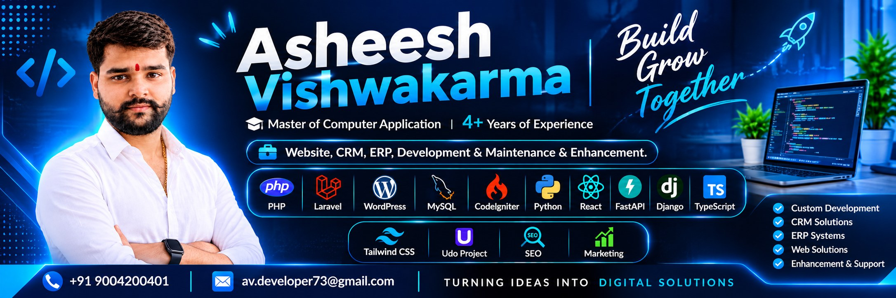

<p align="center">
  
</p>

<h1 align="center">Namaste 🙏, I'm Asheesh Vishwakarma</h1>

<p align="center">
  <a href="https://git.io/typing-svg">
    
  </a>
</p>

<p align="center">
  <a href="https://ashishvdeveloper.github.io/portfolio/"></a>
  <a href="mailto:av.developer73@gmail.com"></a>
  <a href="https://wa.me/919004200401"></a>
  
</p>

---

## 👨‍💻 About Me

I'm a **Full-Stack Developer** from **Airoli, Navi Mumbai** 🇮🇳 with **4+ years** of professional experience building real-world business software - multi-company **CRMs**, **ERPs**, **eCommerce** stores, booking platforms and event portals.

I work across **PHP** (Laravel, CodeIgniter), **Python** (FastAPI, Django) and **JavaScript** (React, Node.js), with MySQL and PostgreSQL underneath.

```php
<?php

class AsheeshVishwakarma
{
    public string $role       = 'Senior Software Developer & Team Lead';
    public string $company    = 'A One Salasar Pvt Ltd, Thane';
    public string $location   = 'Airoli, Navi Mumbai, India';
    public string $education  = 'MCA – Mumbai University';
    public string $experience = '4+ years';

    public array $expertise = ['Laravel', 'CodeIgniter 4', 'Core PHP', 'MySQL', 'REST APIs'];
    public array $builds    = ['CRM', 'ERP', 'eCommerce', 'Booking', 'Event Portals'];
    public array $python    = ['Python', 'FastAPI', 'Django'];
    public array $js        = ['React', 'Node.js', 'TypeScript'];
    public array $data      = ['MySQL', 'PostgreSQL'];

    public function motto(): string
    {
        return 'Turning ideas into digital solutions 🚀';
    }
}
```

- 🔭 **20+ projects** delivered across CRM, ERP, eCommerce, booking and event domains
- 🔗 Integrated **Razorpay**, **IndiaMART** and other third-party APIs, plus mobile-app REST APIs
- ⚡ Optimised front-end and server-side code to cut page-load times
- 🤖 Building a **Garment ERP** with **Python FastAPI + React + PostgreSQL** and an **AI voice assistant**
- 👔 **Senior Software Developer & Team Lead** at **A One Salasar Pvt Ltd**, Thane
- 💼 Open to **freelance** work: websites, CRM/ERP development, maintenance & enhancement
- 📫 Reach me at **av.developer73@gmail.com**

---

## 🛠️ Tech Stack

<p align="center">
  
  <br/><br/>
  
</p>

<p align="center">
  
  
  
  
  
  
</p>

---

## 🚧 Currently Working On

| Project | What it is | Stack | Status |
|---|---|---|---|
| 📦 **Order Management System** | End-to-end order handling — order intake, processing, tracking and reporting | — | 🟡 In development |
| 🤝 **[Metso CRM](https://metso.aonesalasar.com/login)** | CRM to manage leads, customers and sales activity | — | 🟡 In development |
| 🧵 **Garment ERP** | ERP for the garment industry — production, inventory, orders and operations, with a built-in **🎙️ AI voice assistant** | Python **FastAPI** · **React** · **PostgreSQL** | 🟡 In development |

<details>
<summary><b>🧵 Garment ERP — technical overview</b></summary>
<br/>

```text
┌──────────────────────┐     REST / JSON      ┌───────────────────────┐      SQL      ┌──────────────┐
│  React frontend (UI) │ ───────────────────▶ │  FastAPI backend (Py) │ ────────────▶ │  PostgreSQL  │
│  + 🎙️ voice assistant │ ◀─────────────────── │  APIs & business logic│ ◀──────────── │   database   │
└──────────────────────┘                      └───────────────────────┘               └──────────────┘
```

- **Frontend:** React single-page app for the ERP modules, with an AI voice assistant built into the interface
- **Backend:** Python FastAPI serving the REST APIs and business logic
- **Database:** PostgreSQL

</details>

## ✅ Recently Completed

| Project | What it is | Stack | Status |
|---|---|---|---|
| 👥 **[Client Hub](https://client-hub.aonesalasar.com/login)** | Central portal to manage clients, their details and interactions in one place | PHP · MySQL | 🟢 Completed |
| 🛒 **[Jiami.in](https://jiami.in/dev)** | Full eCommerce store — product catalogue, auth, cart & checkout, payment gateway | Laravel / CodeIgniter · MySQL | 🟢 Completed |

## 🧪 Side Projects

| Project | What it is | Stack |
|---|---|---|
| 💌 **[Shubh Vivah Nimantran](https://github.com/AshishVDeveloper/dhiraj)** | Digital Hindi wedding invitation — personalised cards per guest, bulk PDF/image + ZIP export, direct WhatsApp sharing | HTML · JavaScript |
| 🪔 **[Diwali Greetings + Games](https://github.com/AshishVDeveloper/test_web)** | Personalised greeting pages with signed links & QR codes (single + bulk CSV/JSON), plus browser games incl. peer-to-peer multiplayer Snake | HTML · JavaScript · PeerJS |

---

## 🌟 Featured Projects

<table>
<tr>
<td width="50%" valign="top">

### 🏢 [TINT CRM](https://www.tintcrms.com)
CRM running employee & business activity across **4 integrated companies** — multi-company mapping, role-based permissions, leave, expense & invoice management, **IndiaMART API** integration.

`Laravel` `MySQL` `REST API`

</td>
<td width="50%" valign="top">

### 🏠 [Auctionwale](https://www.auctionwale.com)
Property listing & auction platform — master management, **Excel bulk upload** for properties, dynamic listings and **Razorpay** payments.

`Laravel` `MySQL` `Razorpay`

</td>
</tr>
<tr>
<td width="50%" valign="top">

### 💎 [Manekratna](https://www.manekratna.com)
End-to-end jewellery eCommerce — dynamic storefront, admin panel, catalogue, order & **invoice generation**, payment gateway.

`CodeIgniter 4` `MySQL` `eCommerce`

</td>
<td width="50%" valign="top">

### 📁 [Pamcal CRM](https://pamcalapp.com/console/admin/login)
Case-management system — configurable masters, **bulk case upload**, performance-based incentive tracking and **APIs for the mobile app**.

`CodeIgniter 4` `REST API` `MySQL`

</td>
</tr>
<tr>
<td width="50%" valign="top">

### 🏗️ [Heritage Synergy Smart Suite](https://heritage.iresolveservices.com/login)
CRM + ERP centralising projects, leads, enquiries and channel-partner data for cross-department teams.

`PHP` `MySQL` `ERP`

</td>
<td width="50%" valign="top">

### ⛺ [Campistaan](https://campistaan.com/)
Camping & tent booking by location — order processing, online payments and manual cash entry for offline bookings.

`CodeIgniter 4` `Payment Gateway`

</td>
</tr>
</table>

<details>
<summary><b>📂 More live projects (click to expand)</b></summary>
<br/>

| Project | Type | Stack |
|---|---|---|
| [Logisync CRM](https://logisync.app) | Logistics CRM | Laravel · MySQL |
| [Khemandas ERP](https://khemandas.iresolveservices.com/index) | ERP – inventory, orders, workflows | PHP · MySQL |
| [Tucana Lights](https://tucanalights.com/) | Lighting eCommerce | PHP · MySQL |
| [AFMT India](https://afmtindia.com/) | Corporate web app | PHP · MySQL |
| [IIFJAS](https://iifjs.com/) | Fashion jewellery show – event & exhibitor management | CodeIgniter 4 |
| [Met and HTS](https://metandhts.com/) | Business web app | Laravel |
| [Ledex – Jasper Tech Labs](https://jaspertechlabs.com/ledex/home/myProfile) | Profile & business management | PHP · MySQL |
| [PKnit – Jasper Tech Labs](https://jaspertechlabs.com/pknit_live/) | Textile/knitting business app | PHP · MySQL |
| [Portfolio](https://ashishvdeveloper.github.io/portfolio/) | Personal portfolio with JSON-driven admin | HTML · JS |

</details>

---

## 💼 Experience

**Senior Software Developer & Team Lead** — *A One Salasar Pvt Ltd*, Thane, Maharashtra &nbsp;·&nbsp; `Oct 2026 – Present` 🟢
- Leading the development team and owning architecture, code reviews and delivery of business applications
- Building and enhancing web, CRM and ERP solutions with PHP, Laravel and MySQL

**Junior PHP Developer** — *I Resolve Services Pvt Ltd*, Mulund, Mumbai &nbsp;·&nbsp; `June 2022 – Oct 2026`
- Planned, coded and deployed web applications using PHP, MySQL and JavaScript
- Built back-end components and REST APIs; integrated IndiaMART, Razorpay and other third-party services
- Reduced page-load times by optimising HTML, CSS and JavaScript
- Built validated, user-friendly forms; managed all projects with Git

## 🎓 Education

| Degree | Institute | University |
|---|---|---|
| 🎓 **Master of Computer Application (MCA)** | Idol College, Kalina, Mumbai | Mumbai University |
| 💻 **B.Sc. Information Technology** (2020) | JK College of Science & Commerce, Ghansoli | Mumbai University |

### 📜 Certifications

| Certificate | Issued by |
|---|---|
| 🛡️ **Ethical Hacking** | NPTEL |
| 🗄️ **Database Management System** | NPTEL |

---

## 🧰 Services I Offer

| ✅ Custom Development | ✅ CRM Solutions | ✅ ERP Systems | ✅ Web Solutions | ✅ Enhancement & Support |
|:---:|:---:|:---:|:---:|:---:|
| Tailor-made PHP apps | Leads, sales, HR, invoices | Inventory, orders, workflows | Business sites & eCommerce | Bug fixes, speed, new features |

---

## 📊 GitHub Stats

<p align="center">
  
  
</p>
<p align="center">
  
</p>
<p align="center">
  
</p>

---

## 🤝 Let's Build Together

<p align="center">
  Have a website, CRM or ERP idea? Let's talk.<br/><br/>
  <a href="https://ashishvdeveloper.github.io/portfolio/#contact"></a>
  <a href="mailto:av.developer73@gmail.com"></a>
  <a href="https://wa.me/919004200401"></a>
</p>

---

## ☕ Support My Work

<p align="center">
  If my projects or code helped you, you can buy me a chai via UPI 🙏<br/><br/>
  <br/>
  <b>UPI ID:</b> <code>9004200401@kotakbank</code><br/>
  <sub>Scan with GPay, PhonePe, Paytm or any UPI app</sub><br/><br/>
  <a href="https://ashishvdeveloper.github.io/portfolio/#support"></a>
</p>

<p align="center"><i>“Turning ideas into digital solutions.”</i> ✨</p>

<p align="center">
  
</p>
